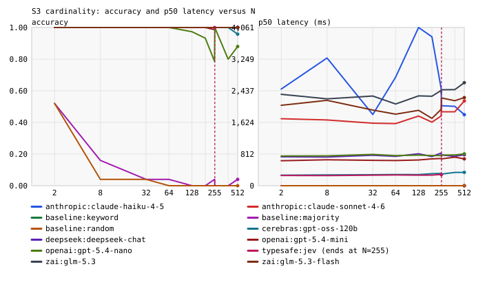

# DMB — decision-model benchmark

DMB measures typed choices: pick one of N options and return a confidence
score. It compares jev, eight constrained LLM configurations, and three
deterministic baselines across five suites. The results describe these
endpoints, prompts, and datasets; they do not establish a winning model class.

The [v3 report](results/v3/v3.md) is the report of record. Its
[correction note](results/v3/CORRECTIONS.md) explains the corrected S4/S5
interpretations, historical cost limitations, and archive sanitization.
Machine-readable metrics, paired item-cluster uncertainty, descriptive
risk/coverage curves, plots, and sanitized observations live in
[results/v3](results/v3/).

## Findings supported by the historical observations

- Banking accuracy ranges from 70.9% to 81.3% among the LLM endpoints;
  jev scores 76.3%. On spam, glm-5.3 leads at 94.9%, followed by jev
  at 93.0% and glm-5.3-flash at 91.4%.
- jev's measured median request latency is 264–276 ms across suites.
  Cerebras gpt-oss-120b is close at 303–346 ms. These measurements do
  not substantiate a general 40–200× speed claim.
- jev succeeds on the planted code-word task through 255 choices and
  rejects requests at 256, 384, and 512 choices. Every tested LLM
  endpoint produces valid decisions with 512 choices.
- Historical pooled S4 instability is 13% for jev and 37% for mini.
  That statistic combines repeat variability and option permutations.
  Identical-order repeats also change on 5% and 25% of base items,
  respectively. v3 reports these effects separately; this experiment
  does not isolate a causal position bias.
- S5 confidence differs across endpoints, but historical prompts gave
  unequal uncertainty instructions and jev's score is provider-defined.
  The original “only jev bluffs” verdict was unsupported. The reported
  ECE 0.246 concerns the underdetermined half, whose reference answer
  was randomly planted; it excludes no-good-option items.
- The original nominal S1 cost ratio of nano to jev is about 2.49×,
  using unrounded values. Exact historical bills are unknown: retry
  usage is incomplete and snapshots omit cache rates. v3 distinguishes
  known cost subtotals from historical nominal calculations. jev's
  price remains a vendor claim, and gateway invoices were not reconciled.



## Reproduce the published correction without paid calls

Python 3.12 and `uv` are required.

```bash
uv sync --locked
uv run dmb build
uv run python scripts/regenerate_corrections.py
uv run pytest
uv run ruff check .
```

Input downloads are pinned by exact checksums, including cached bytes.
Banking77 is pinned to a complete repository commit containing its license.
All five released item hashes match the rebuilt files. The correction
script reads the three published archives, checks source snapshots and
numeric observations, regenerates v3, and sanitizes every archive. It
makes no provider calls.

## Run a new benchmark

Set keys for the selected contenders: `OPENAI_API_KEY`,
`ANTHROPIC_AUTH_TOKEN`, `ZAI_API_KEY`, `DEEPSEEK_API_KEY`,
`CEREBRAS_API_KEY`, and `TYPESAFE_API_KEY`. Missing keys cause recorded
skips. Cerebras defaults to the priced `gpt-oss-120b`; an explicitly
selected unpriced model fails before setup calls.

```bash
uv run dmb run --run-id smoke --smoke
uv run dmb report runs/smoke --out results/smoke
```

New runs use protocol v3. Setup probes have a bounded negotiation phase;
all probe outcomes and usage are recorded, and effective configuration
is frozen before scoring. Every scored attempt retains provider usage,
including cache fields. An unknown rate or usage component is reported
explicitly; it cannot contribute a fictitious measured zero to the budget.
The $40 budget target is informational; the $60 hard cap applies to
priced observed usage. Requests already in flight can overshoot the cap
and complete after a stop; their results and usage are retained. Failed
requests with unreported usage remain an explicit accounting limitation.

Run IDs are new directory names. Existing run directories are never
resumed or overwritten. Exit codes are 0 complete, 2 invalid configuration
or run ID, 3 execution failure, 4 budget/accounting stop, 5 authentication stop,
6 deadline stop, and 130 interruption. Partial runs retain terminal
manifests and all started attempts.

## Files and provenance

- [SPEC.md](SPEC.md): suites, metrics, execution rules, and protocol history.
- `data/suites/*.jsonl`, `hashes.json`: rebuilt items and source checksums.
- `runs/<id>/manifest.json`: protocol, effective settings, hashes, status,
  coverage, accounting, deviations, and skips.
- `runs/<id>/prices.snapshot.json`: exact dated price table, verified by hash.
- `runs/<id>/results.jsonl`, `raw/*.jsonl`: local results and attempt/probe logs.
- [results/v3](results/v3/): generated corrected report and sanitized archive.
- `results/v1*`, `results/v1.1*`, `results/v2`: historical numeric reports
  retained with correction notices. Their archives have been sanitized.
- [blog/v1-post.md](blog/v1-post.md): revised narrative; publishing is manual.

Reports validate items, rows, price snapshots, and protocol provenance
before merging. Later runs replace earlier cells whole, including failed
cells. Protocol mixing requires `--allow-protocol-mix` and is visible.

## Data and publication policy

S1 and S4 use Banking77 under CC BY 4.0 with attribution; S4 is a
permutation derivative of S1. The [UCI SMS Spam Collection page](https://archive.ics.uci.edu/dataset/228/sms+spam+collection)
currently lists CC BY 4.0. DMB nevertheless keeps SMS message text local
as its privacy policy. Published S2 records contain approved metadata
only, including shared logs, errors, reasoning, and probe files. S3 and
S5 are generated from seed 20260918.

No vendor sponsorship. Negative results and missing measurements remain
visible. Descriptive confidence curves do not select a deployment
threshold: select thresholds on separate held-out data and report the
resulting coverage and error rate.
